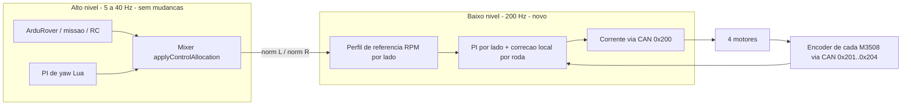
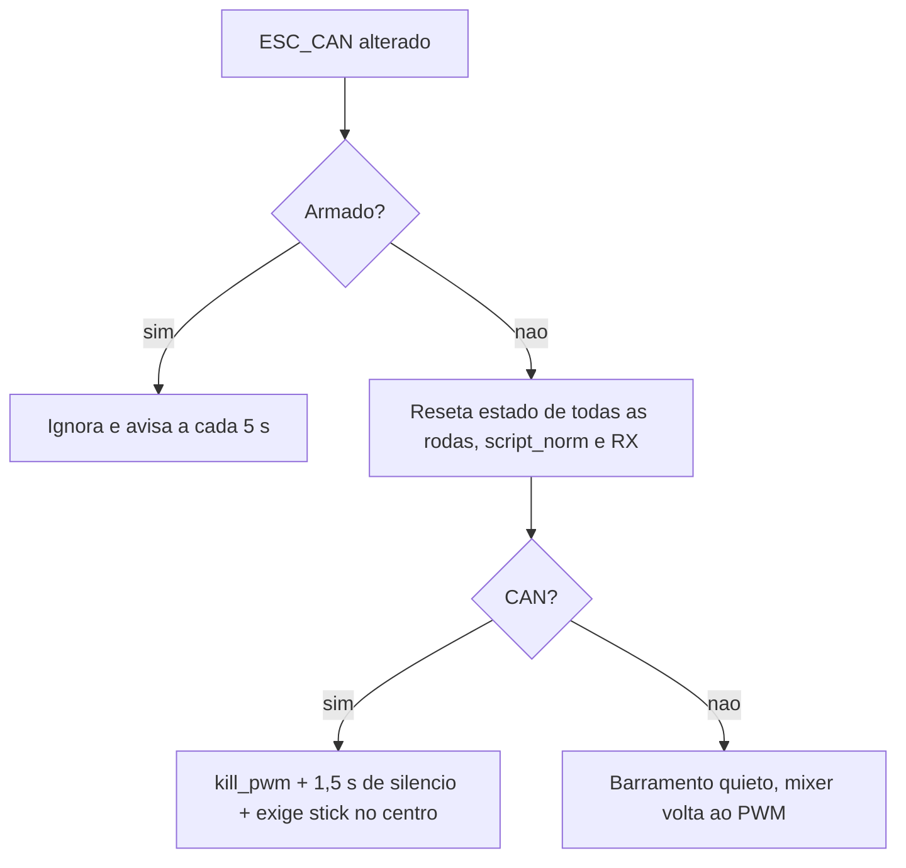
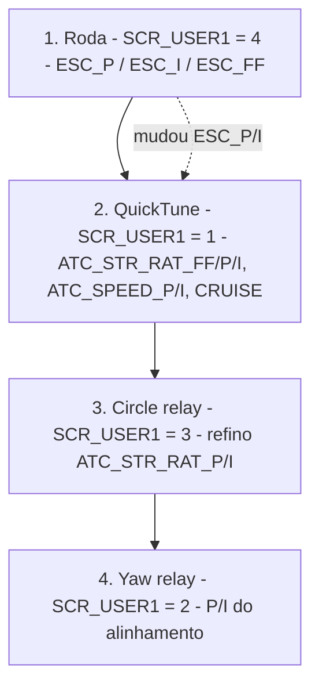
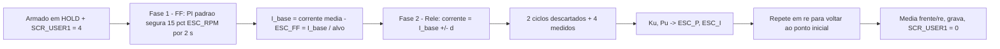
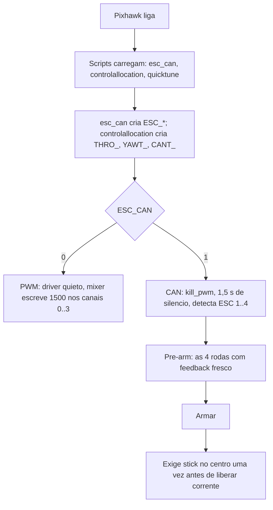
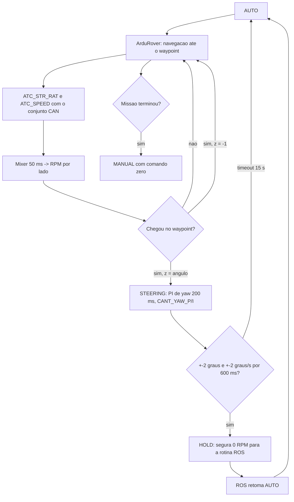
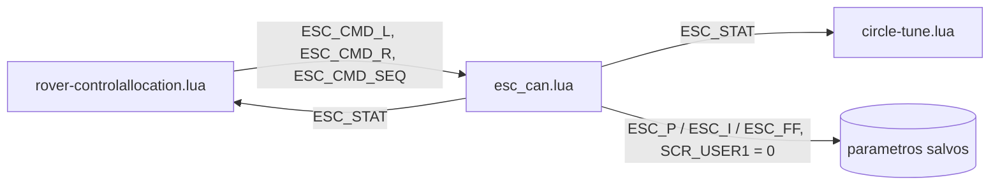

# Controle de velocidade por roda via CAN (C620 / M3508)

Esquema de como o rover deve passar do acionamento PWM atual para um acionamento CAN com **referência de velocidade por roda** e **realimentação do encoder de cada roda**, mantendo a mesma lógica de alto nível (mixer, missões, autotunes) que já funciona em PWM.

Base usada:

- `Rover/scripts/rover-controlallocation.lua` (mixer + autotunes do Vinicius, testados em campo).
- `C:\Users\daviv\Documents\CAN-works\c620_can.lua` e `ANALISE_FLUXO_C620.md` (driver CAN que funcionou, com PI de velocidade por roda).

> O `Rover/scripts/c620_can.lua` desta branch é uma versão **anterior** à de `CAN-works` (não tem janela de silêncio, flush de RX nem `kill_pwm` contínuo). A implementação deve partir da versão de `CAN-works`.

> Para uma leitura rápida do funcionamento completo (boot, manual, autônomo, tuning em campo e falhas), ver a **seção 11**.

---

## 1. Ideia geral

Hoje o PWM é **malha aberta na roda**: o mixer calcula um PWM por lado e o ESC aplica, sem saber se a roda realmente atingiu a velocidade. Qualquer diferença de piso, carga ou motor vira erro que só é corrigido lá em cima, pelo PID de yaw (5 Hz) ou pelo controlador nativo do ArduPilot.

Com CAN o mixer continua produzindo exatamente o mesmo comando normalizado esquerdo/direito, mas esse comando passa a ser uma **referência de RPM** para cada lado. Um PI rápido por lado (200 Hz) fecha a malha com os encoders dos M3508, e uma correção local equaliza as duas rodas de cada lado, antes que o erro apareça no yaw ou na trajetória.



Hierarquia de malhas (de dentro para fora):

| Malha | Onde roda | Período | Entrada | Saída | Ganhos |
|---|---|---|---|---|---|
| Corrente | Firmware do C620 | ~1 kHz | corrente (A) | tensão no motor | fixo DJI |
| **Velocidade do lado (nova)** | `esc_can.lua` | 5 ms | RPM de referência | corrente (A) | `ESC_P/I/FF/IMAX`, `ESC_LOC_*` |
| Taxa de giro / velocidade | ArduRover nativo | 50 Hz | trajetória | throttle, steering | `ATC_STR_RAT_*`, `ATC_SPEED_*` (conjunto do caminho ativo) |
| Alinhamento de yaw | `rover-controlallocation.lua` | 200 ms | heading alvo | steering | PWM: `SCR_USER2/3`; CAN: `CANT_YAW_P/I`; ambos × `YAWT_GAIN_MULT` |

Regra prática: cada malha deve ser pelo menos ~5× mais rápida que a de fora. 200 Hz na roda contra 5–20 Hz no mixer atende com folga.

---

## 2. Como o caminho PWM funciona hoje (passo a passo)

### 2.1 Mixer

`applyControlAllocation(t, s)` recebe throttle `t` e steering `s` em `[-1, 1]`:

1. `pwm_range = 5 × THRO_MAX_LUA` (90% → ±450 µs).
2. `allocateRightAndLeftPwmShare` divide o "orçamento" entre throttle e steering e devolve `aloc_l`, `aloc_r` em `[-pwm_range, +pwm_range]`.
3. `pwm_l = 1500 + aloc_l` e `pwm_r = 1500 − aloc_r` (o lado direito é invertido no PWM porque os motores estão espelhados).
4. Escreve canal 0 = R, 1 = L, 2 = L, 3 = R com timeout de 300 ms (60 ms em Circle).

### 2.2 Quem chama o mixer, por modo

| Modo | Função | Período | Origem de `t`, `s` |
|---|---|---|---|
| Desarmado | `notArmed` | 2000 ms | trim 1500 nos 4 canais |
| MANUAL | `applyPWMManualMode` | 200 ms | RC1/RC3 com suavização |
| AUTO | `applyPWMAutoMode` | 200 ms | `get_control_output` do ArduRover |
| AUTO → waypoint com yaw | `triggerYawControlOnReachedWaypoint` → STEERING | — | para e troca de modo |
| STEERING | `applyPWMSteeringMode` | 200 ms | `t = 0`, `s = PI de yaw` |
| HOLD / GUIDED | — | 200 ms | `0, 0` |
| CIRCLE | `applyPWMInternalControl(60)` | 25 ms | ArduRover nativo |
| ACRO / RTL / SIMPLE | `applyPWMInternalControl` | 200 ms | ArduRover nativo |
| `SCR_USER1 = 2` | `runYawAutotune` | 200 ms | relé de yaw → `s` |
| `SCR_USER1 = 3` em CIRCLE | `circle_tune:update` | 25 ms | relé em torno do steering nativo |
| `SCR_USER1 = 1` | QuickTune (outro script) | 25 ms | ajusta `ATC_*`, mixer só repassa |

### 2.3 Limitação

Entre duas chamadas do mixer (200 ms) nada corrige a roda. Se uma roda patina, pega carga ou um motor rende menos, a diferença só aparece como erro de yaw ou de trajetória e é corrigida pelas malhas lentas.

---

## 3. Como deve funcionar em CAN (passo a passo)

### 3.1 Conversão do comando do mixer em referência de RPM

Manter **a mesma conta** do PWM, só trocando o destino:

```text
aloc_l, aloc_r = allocateRightAndLeftPwmShare(t, s, 5 × THRO_MAX_LUA)   -- igual ao PWM
norm_l = aloc_l / 500        -- mesma fração do PWM (90% → no máximo 0,9)
norm_r = aloc_r / 500        -- sinal positivo = para frente nos DOIS lados
rpm_ref[roda] = norm_lado × ESC_RPM
```

- Dividir por 500 (e não por `pwm_range`) faz `THRO_MAX_LUA` limitar a velocidade no CAN do mesmo jeito que limita o PWM.
- No CAN **não** se inverte o lado direito no mixer: positivo é sempre para frente. A inversão física de cada motor fica só em `ESC_REV`.
- O mixer grava `ESC_CMD_L`, `ESC_CMD_R` e incrementa `ESC_CMD_SEQ` (parâmetros só em RAM) e **não escreve PWM**. Os scripts Lua do ArduPilot rodam isolados e não compartilham variáveis globais, por isso a comunicação é por parâmetro (seção 12).

Resultado: com o mesmo `t, s`, a roda passa a pedir uma velocidade, não um PWM. Toda a lógica de cima (modos, missão, yaw, Circle, QuickTune) continua igual.

### 3.2 Malha rápida por roda (`esc_can.lua`, a cada 5 ms)

Para cada ESC `i` saudável:

```text
1. drain(): lê até 25 frames 0x201..0x208 → rotor_rpm, ângulo, corrente, temperatura
2. wheel_rpm = ESC_REV(i) × rotor_rpm / ESC_GEAR
3. cmd = norm do mixer (se fresco < 500 ms)
4. ref = perfil(cmd)          -- interpola entre amostras do mixer + limita aceleração (seção 3.6)
5. target_rpm = ref × ESC_RPM
6. err = target_rpm − rpm_medido   (média do lado + correção local, seção 3.3)
7. I += ESC_I × err × dt   (só se não saturado no mesmo sentido do erro)
8. corrente = sat(ESC_FF × target + ESC_P × err + I, ±ESC_CUR)
9. raw = ESC_REV(i) × corrente × 819,2  → frame 0x200 (ESC 1..4)
```

A base já existe na versão de `CAN-works`. Mudam o passo 4 (perfil de referência no lugar da `C620_RAMP`, que foi removida), o passo 6 (controle por lado) e o corte de corrente do `ESC_BRK = 0` vira um limite de corrente de frenagem (seção 3.7).

### 3.3 Controle por lado com correção local por roda

Quatro PIs totalmente independentes **brigam entre si** num skid-steer. As duas rodas do mesmo lado estão presas ao mesmo chassi e ao mesmo chão. Numa curva elas arrastam lateralmente e não conseguem seguir cada uma o seu alvo. Se uma acelera um pouco, a outra é puxada, e cada PI tenta corrigir o efeito do outro. Isso aparece como vibração, ruído e correntes opostas nas rodas de um mesmo lado.

Estrutura proposta, com duas camadas no mesmo loop de 5 ms:

```text
rpm_lado   = média(rpm_frente, rpm_trás)                -- feedback do lado
I_lado     = PI_lado(ref_lado − rpm_lado)               -- ESC_P / ESC_I
e_k        = rpm_lado − rpm_k
atrito_k   = sinal(ref_lado) × (ESC_FRk − média(ESC_FR do lado))
I_roda(k)  = I_lado + sat(ESC_LOC_P × e_k + ∫ ESC_LOC_I × e_k + atrito_k, ±ESC_LOC_MAX)
```

- O **PI do lado** é o que segue a referência. É ele que o autotune de roda ajusta (seção 6.2).
- A **correção local** só equaliza as duas rodas do mesmo lado e tem limite pequeno (`ESC_LOC_MAX`, por exemplo 15% de `ESC_CUR`). A soma da correção nas duas rodas de um lado é zero, então ela não muda a corrente total do lado.
- O **integral local** (`ESC_LOC_I`, padrão 0,5) resolve o caso de baixa velocidade em que só uma roda anda: a roda parada no atrito estático recebe corrente até soltar. Ele zera com o comando no centro.
- A **compensação de atrito** usa `ESC_FRn`, medido pelo teste de arranque (`SCR_USER1 = 5`). Assim as rodas saem juntas já no primeiro instante, sem esperar o integral carregar.
- `ESC_LOC_P` e `ESC_LOC_I` saem do relé diferencial (`SCR_USER1 = 6`), seção 6.7.

### 3.4 Outras proteções locais

| Problema | Proposta | Por quê |
|---|---|---|
| Uma roda satura em corrente e as outras não | **Dessaturação por lado:** se alguma roda passou de `ESC_CUR`, reduzir a referência das quatro na mesma proporção, preservando a razão L/R | Sem isso o rover muda de curva sozinho quando uma roda bate no limite |
| Roda patinando (RPM muito acima da outra do mesmo lado) | **Detecção de patinagem:** `|rpm_k − rpm_lado| > ESC_SLIP` por mais de 100 ms → logar e avisar. A correção local da seção 3.3 já reduz a corrente dessa roda | Evita cavar o piso e dar erro de yaw |
| ESC perdido | **Parar as quatro** (não só a perdida) e avisar | Com uma roda morta o skid-steer gira no lugar |

A dessaturação e a patinagem ficam no `esc_can.lua`, depois de calcular a corrente e antes de montar o frame.

### 3.5 O que muda em cada modo

| Modo | Mudança no CAN |
|---|---|
| Desarmado | `notArmed` **não pode** escrever 1500 nos canais 0..3: qualquer pulso tira o C620 do CAN. Em CAN escreve largura 0, limpa `script_norm` e zera a suavização do MANUAL (correção já documentada em `CAN-works`) |
| MANUAL | O stick vira RPM em vez de PWM. Mixer a 50 ms. A suavização `applyAbsSmoothing` é desligada em CAN e substituída pelo limite de aceleração `ESC_ACC` (seção 3.6). **Stick no centro = rover segurando 0 RPM**, não solto como no PWM |
| AUTO | Igual. `get_control_output` → mixer → RPM |
| STEERING (alinhamento de yaw) | Igual. O PI de yaw passa a comandar diferença de velocidade entre os lados em vez de diferença de PWM. Usa `CANT_YAW_P/I`, ajustados pelo relé de yaw em CAN (seção 6.5); `SCR_USER2/3` ficam para o PWM |
| HOLD / GUIDED | `0, 0` vira **segurar 0 RPM** ativamente (o PI segura o rover parado, inclusive em rampa) |
| CIRCLE | Igual, a 25 ms. `circle_tune:log_sample` continua recebendo um PWM equivalente para log |
| ACRO / RTL / SIMPLE | Igual |
| LOITER / SMART_RTL | **Hoje param o rover** nos dois caminhos: não estão tratados no `update` do Vinicius e caem em "modo não tratado → 0, 0". Se algum failsafe estiver configurado para SmartRTL ou Loiter, o rover fica parado. Pendência (seção 10) |

### 3.6 Perfil de referência (fluidez)

O mixer manda uma referência nova a cada 200 ms na maioria dos modos (25 ms em CIRCLE). Uma malha de roda rápida segue fielmente o que recebe. Se receber **degraus** de 200 ms, ela produz **degraus de velocidade**: um tranco a cada 200 ms, cinco vezes por segundo. No PWM isso não aparecia porque o ESC em malha aberta e a inércia do motor já filtravam o degrau.

A `C620_RAMP` de `CAN-works` não resolve: ela só suaviza a **subida**. Reduzir ou inverter o comando passa direto, o que dá tranco na desaceleração e nas correções de curva.

Proposta, aplicada no driver a cada 5 ms, por lado:

1. **Interpolação entre amostras do mixer:** o driver mede o intervalo entre incrementos de `ESC_CMD_SEQ` (50 ms, 25 ms...) e leva a referência do valor anterior ao novo, em linha reta, ao longo desse intervalo. A referência vira uma curva contínua, com um atraso de um período do mixer.
2. **Limite de aceleração simétrico:** `|Δref/Δt| ≤ ESC_ACC` (RPM/s), valendo para acelerar **e** para desacelerar. É o que define a "sensação" do rover.
3. **Parada de emergência e desarme** ignoram o perfil e zeram na hora.

Com isso a rampa de subida de `CAN-works` foi removida; o `ESC_ACC` vale para os dois casos (`SCR_USER5 = 2` e `SCR_USER5 = 0`).

A interpolação atrasa a referência em um período do mixer. A 200 ms isso seria sentido no stick e entraria na malha do PI de yaw. Por isso, **em CAN, o mixer roda a 50 ms em MANUAL, AUTO, STEERING, HOLD e no relé de yaw** (CIRCLE continua a 25 ms):

- O PI de yaw e o relé de yaw continuam calculando a cada 200 ms com `dt = 0,2 s`. Nos ciclos intermediários o mixer repete o último `s`. O timeout de 15 s do alinhamento passa a ser contado em tempo, não em número de chamadas.
- Relé de yaw e alinhamento usam **o mesmo** período de mixer (50 ms). Assim o atraso que o relé mede é o mesmo que o PI vai encontrar ao usar os ganhos.
- Em MANUAL, a `applyAbsSmoothing` é por chamada: rodando 4× mais rápido ela mudaria a resposta. Em CAN ela é desligada e o `ESC_ACC` faz o papel de suavização.

**No PWM todos os períodos e a suavização continuam como o Vinicius fez.**

### 3.7 Frenagem (`ESC_BRK`)

Na versão de `CAN-works`, com `ESC_BRK = 0` a corrente é cortada quando ela é contrária ao giro da roda. Isso impede:

- **desacelerar com controle:** o rover só para por atrito e passa do ponto;
- **segurar parado em HOLD**, principalmente em rampa;
- **fazer curva no skid-steer:** as rodas de dentro precisam de torque contrário ao giro para arrastar e virar o chassi. Sem isso a curva sai mais aberta e irregular, e o PI de yaw compensa aos trancos.

Proposta: em CAN com o mixer, `ESC_BRK = 1`. A proteção contra regeneração passa a ser limitar a **corrente de frenagem** (`ESC_BRKCUR`, por exemplo 30% de `ESC_CUR`) em vez de cortar. Confirmar se a bateria e o BMS aceitam essa regeneração.

### 3.8 Quando o mixer para de mandar referência

Hoje, se `script_norm` fica velho (> 500 ms), o driver cai para `SRV_Channels:get_output_scaled` (funções 73/74/70), que é a mistura **do ArduRover**, diferente da do Lua.

Proposta: com `SCR_USER5 = 2` (mixer Lua ativo), referência velha → **0 RPM**. O fallback para as saídas do ArduRover fica só para `SCR_USER5 = 0`.

---

## 4. Troca CAN ↔ PWM

Mantém as regras do driver de `CAN-works`:



O mixer decide o caminho a cada chamada lendo o bit 0 de `ESC_STAT`, publicado pelo driver (`can_selected()`).

### 4.1 Garantia: PWM igual ao do Vinicius

Com `ESC_CAN = 0` o rover deve se comportar **exatamente** como o `rover-controlallocation.lua` do Vinicius testado em campo. Regras para a implementação:

1. **Todo código novo fica atrás de `if can_selected() then ... end`.** Fora desse `if`, as funções do mixer ficam linha a linha iguais às do Vinicius: conta do PWM, sinais, canais, timeouts, períodos (200 ms / 25 ms), suavização do MANUAL, autotunes e a sequência de headings.
2. **`notArmed` em PWM continua escrevendo 1500** nos quatro canais. Só em CAN escreve 0.
3. **Ganhos de PWM intocados:** `SCR_USER2/3`, `YAWT_MAX_OUT`, `YAWT_MAX_ANG`, `YAWT_GAIN_MULT`, `CTUN_*`, `RTUN_*` e os `ATC_*` de PWM continuam sendo os usados pelo caminho PWM. Os ajustes de CAN vão para parâmetros próprios (`CANT_*`, seção 6.6). Nenhum autotune em CAN escreve num parâmetro de PWM.
4. **Driver silencioso em PWM:** com `ESC_CAN = 0` o `esc_can.lua` não manda frame, não escreve PWM e não mexe nos canais 0..3. Só lê o barramento.
5. **`ESC_CAN` com padrão 0.** Na versão de `CAN-works` o padrão é 1: um cartão novo ou um parâmetro resetado entraria em CAN sozinho e mataria os pulsos PWM.
6. **`SCR_USER1 = 4` em PWM** só avisa e não faz nada.
7. **Verificação antes de ir a campo:** desarmado, `ESC_CAN = 0`, comparar os PWM de saída (`RCOU`) do script novo com os do script do Vinicius para os mesmos sticks e modos. Precisam ser idênticos.

O único custo em PWM é o `esc_can.lua` carregado ocupando memória e CPU do Lua. Conferir `SCR_HEAP_SIZE` e o tempo de execução dos scripts.

---

## 5. Mapeamento das rodas (confirmar antes de tudo)

Existem duas convenções em conflito:

| Fonte | ESC 1 | ESC 2 | ESC 3 | ESC 4 |
|---|---|---|---|---|
| PWM atual (canais 0..3) | R | L | L | R |
| Mixer de `CAN-works` (`set_norms`) | L | L | R | R |

O driver identifica a roda pelo ID CAN (ESC 1 = `0x201`), que é configurado no C620, não pelo cabo PWM. Antes de qualquer teste em movimento:

1. Rover sobre cavaletes, `ESC_CAN = 1`, armado em MANUAL.
2. Throttle leve para frente: as quatro rodas devem girar para frente e `DJIC.Rpm` deve ser **positivo** nas quatro. Se não, ajustar `ESC_REV`.
3. Steering leve para a direita: as rodas da esquerda aceleram e as da direita desaceleram (ou invertem).
4. Anotar a tabela real ESC → posição e fixá-la no mixer como uma tabela única (`WHEEL_SIDE = { 'R', 'L', 'L', 'R' }` ou o que o teste mostrar).

---

## 6. Autotunes no CAN

Objetivo: os mesmos autotunes testados ontem em PWM (QuickTune, relé em Circle, relé de yaw) funcionam também em CAN. Um quarto autotune, com o mesmo relé, ajusta a malha interna da roda.

### 6.1 Princípio

Cada autotune enxerga como "planta" tudo o que está abaixo dele:

| Autotune | Planta em PWM | Planta em CAN |
|---|---|---|
| Roda (novo) | — | motor + caixa + roda + C620 (malha de corrente) |
| QuickTune / Circle relay | mixer + ESC em malha aberta + rover | mixer + **malha de roda fechada** + rover |
| Yaw | mixer + ESC em malha aberta + rover | mixer + **malha de roda fechada** + rover |

Os três autotunes de cima não precisam de lógica nova: eles mandam `t, s` para o mixer e medem a resposta pelo AHRS. Como o mixer CAN usa a mesma conta do PWM (seção 3.1), o caminho de comando deles é o mesmo. O que muda é a planta, então **os ganhos encontrados em PWM e em CAN são diferentes** e cada caminho precisa do seu conjunto (seção 6.6).

A malha de roda precisa ser ajustada **primeiro**: enquanto `ESC_P/I` mudar, a planta dos outros três muda junto.



### 6.2 Autotune da malha interna (roda) — `SCR_USER1 = 4`

Mesmo método dos testes de ontem: relé de Åström–Hägglund com regra PI de Tyreus–Luyben, reaproveitando `modules/autotune.lua`. Muda a unidade (erro em RPM, saída em A) e o lugar onde roda.

**Onde roda:** dentro do `esc_can.lua`, no loop de 5 ms. O mixer (200 ms) é lento demais para essa malha. O próprio driver lê `SCR_USER1 = 4` e o modo HOLD, ignora o comando do mixer durante o ensaio, manda as mensagens `WheelTune:`, grava os ganhos e volta o seletor. O estado sai em `ESC_STAT` (bits 2, 3 e 4).

**Sequência:**



1. **Fase FF (feedforward):** o PI com os ganhos padrão segura uma referência baixa (~15% de `ESC_RPM`) por 2 s. A corrente média é a corrente para vencer atrito e manter a velocidade: `I_base`. Daí sai `ESC_FF = I_base / alvo_rpm`.
2. **Fase relé:** o PI é desligado e a corrente alterna entre `I_base + d` e `I_base − d` (`d` ≈ 25% de `ESC_CUR`, limitado entre 0,5 e 5 A), comutando quando o erro `alvo − rpm` cruza a histerese. Mede período `Pu` e amplitude `A` da oscilação de RPM.
3. **Ganhos:** `Ku = 4d / (π√(A² − ε²))`, `Kp = Ku / 3,2`, `Ti = 2,2·Pu`, `Ki = Kp / Ti`. As mesmas fórmulas do yaw.
4. **Ida e volta:** no chão, o ensaio para frente anda alguns metros. Repetir em ré traz o rover de volta e mostra assimetria. Grava a média; se frente e ré diferirem mais de 30%, avisa.

**Por que um ponto de operação diferente de zero:** em torno de 0 RPM o atrito estático e a folga da caixa fazem a roda "grudar" e o relé não forma uma oscilação limpa. A 15% a roda já está girando e a resposta é aproximadamente linear.

**Parâmetros do relé (valores iniciais):**

| Item | Valor | Comentário |
|---|---|---|
| `hyst` | 3% de `ESC_RPM` | acima do ruído do encoder |
| `max_amp` | 60% de `ESC_RPM` | aborta se a roda disparar |
| `min_period_s` | 0,02 s | 4 amostras de 5 ms por ciclo, no mínimo |
| `max_period_s` | 2 s | |
| `timeout_s` | 5 s por sentido | o ensaio é curto porque a malha é rápida |
| `max_spread` | 0,35 | o jitter do Lua espalha mais os períodos que no yaw |

**Cavaletes e chão:**

| Etapa | Para que serve | Observação |
|---|---|---|
| Cavaletes, uma roda por vez | conferir sentido, mapeamento e se o relé oscila | ganhos saem **baixos** (roda sem carga tem pouca inércia); não usar em campo |
| Chão, as quatro juntas | ganhos de campo | o rover anda ~1–2 m para frente e volta em ré |

O relé ajusta o **PI do lado** (seção 3.3): o erro é a média de RPM do lado e a corrente é a mesma nas duas rodas do lado, com a correção local desligada durante o ensaio. Começar com um `ESC_P/I` único para os dois lados. O ensaio já mede cada lado com seu próprio relé e grava a média. Se o log mostrar lados muito diferentes, dá para evoluir para ganhos por lado (não implementado). A correção local tem os próprios ensaios: `SCR_USER1 = 5` (arranque, rodas no ar) e `SCR_USER1 = 6` (relé diferencial), seção 6.7.

**Abortar (corrente zero, ganhos antigos mantidos):** sair de HOLD, desarmar, mudar `SCR_USER1`, ESC perdido, `|rpm| > max_amp`, timeout, stick fora do centro.

**Alternativa se o relé não fechar:** se `Pu` sair perto de 20 ms (a malha de corrente do C620 é muito rápida e o loop Lua não resolve o ciclo), trocar a fase relé por um **degrau de corrente**: ajustar um modelo de primeira ordem (ganho `K` em rpm/A e constante `τ`) e calcular o PI por cancelamento de polo (`Ki/Kp = 1/τ`, `Kp` para uma banda desejada, por exemplo 5 Hz). Mesmo seletor, mesma gravação.

### 6.3 QuickTune em CAN — `SCR_USER1 = 1`

Funciona sem mudança. Ele observa `steering_out` × taxa de giro do giroscópio e `throttle_out` × velocidade do AHRS, e esses sinais existem igual nos dois caminhos.

O que muda no resultado:

- `CRUISE_THROTTLE` fica quase determinístico: com a roda em malha fechada, `throttle × ESC_RPM × THRO_MAX_LUA/100 × 2πR/60 ≈ velocidade`. Serve como verificação: se o valor encontrado fugir muito dessa conta, há patinagem ou o raio/redução está errado.
- `ATC_STR_RAT_FF` cai e fica mais repetível, porque a diferença de RPM entre os lados é imposta pela malha de roda.
- P e I tendem a sair maiores, porque a planta responde mais rápido.

Opcional (pendência na seção 10, não implementado): usar velocidade e taxa de giro dos encoders, publicadas pelo driver em parâmetros, com fallback para AHRS. Ajuda em baixa velocidade, onde a velocidade do GPS é ruidosa, mas superestima se houver patinagem. A versão antiga do CAN já fazia isso e pode ser reaproveitada.

### 6.4 Relé em Circle em CAN — `SCR_USER1 = 3`

Funciona sem mudança na lógica. O relé alterna `s` em torno do steering médio e o mixer transforma isso em diferença de RPM entre os lados.

Ajustes necessários:

- `CircleTune:log_sample` recebe `pwm_l, pwm_r` do mixer. Em CAN o mixer devolve o **PWM equivalente** (`1500 + aloc`) para o log `CRTU` continuar comparável. O RPM real vem do `DJIC`.
- A checagem de "folga" (`throttle < MAX_COMMAND`) continua valendo. Se a malha de roda saturar corrente durante o relé, o driver avisa e o Circle relay cancela com o motivo de saída fora dos limites (o `circle-tune.lua` lê o bit 1 de `ESC_STAT`).
- O período de 25 ms do Circle é 5 vezes o da roda, então a malha interna acompanha cada passo do relé.

### 6.5 Relé de yaw em CAN — `SCR_USER1 = 2`

Funciona sem mudança na lógica. `s = ±d` vira `±d × ESC_RPM` de diferença entre os lados.

O que muda:

- Em PWM, `YAWT_MAX_OUT` precisava passar da zona morta do ESC. Em CAN não existe zona morta (o PI vence o atrito), então o relé pode ser **menor**. Usar um parâmetro próprio, `CANT_YAW_OUT`, começando em 10%, para não alterar o `YAWT_MAX_OUT` de 20% do PWM.
- A oscilação deve ficar mais regular (menos rejeição por `inconsistent cycles`).
- A sequência de verificação 0°/90°/180°/270°/360° continua igual e é o teste final do conjunto.

### 6.6 Dois conjuntos de ganhos: PWM e CAN

Como a planta muda, os ganhos de cima também mudam. Para poder trocar `ESC_CAN` sem perder os ajustes de nenhum dos caminhos:

| Ganho | Em PWM | Em CAN |
|---|---|---|
| Yaw P / I | `SCR_USER2` / `SCR_USER3` (como hoje) | `CANT_YAW_P` / `CANT_YAW_I` (novo) |
| `ATC_STR_RAT_FF/P/I`, `ATC_SPEED_P/I`, `CRUISE_THROTTLE` | valor ativo nos próprios `ATC_*` | cópia em `CANT_*` (novo) |
| Roda | — | `ESC_P/I/FF` |

Funcionamento:

- O autotune grava no conjunto do caminho ativo: em CAN, o yaw relay grava em `CANT_YAW_P/I`; QuickTune e Circle gravam nos `ATC_*`, como hoje, e o mixer copia os `ATC_*` para `CANT_*` a cada desarme em CAN.
- Na troca de `ESC_CAN` (só desarmado), o mixer guarda os `ATC_*` atuais no conjunto do caminho que está saindo e carrega os do caminho que está entrando. Na primeira vez em CAN, se `CANT_*` estiver vazio, usa os de PWM como ponto de partida e avisa no GCS.
- `YAWT_GAIN_MULT` continua valendo para os dois caminhos.

Assim, os ganhos que deram certo ontem em PWM ficam preservados.

### 6.7 Seletor `SCR_USER1` completo

| Valor | Autotune | Caminho | Modo | Ajusta |
|---|---|---|---|---|
| 0 | normal | ambos | — | — |
| 1 | QuickTune | ambos | CIRCLE (recomendado) | `ATC_*`, cruise |
| 2 | relé de yaw | ambos | HOLD (recomendado) | P/I do alinhamento do caminho ativo |
| 3 | relé em Circle | ambos | CIRCLE | `ATC_STR_RAT_P/I` |
| 4 | relé de roda | **só CAN** | HOLD (obrigatório) | `ESC_P/I/FF` |
| 5 | arranque por roda, **rodas no ar** | **só CAN** | HOLD (obrigatório) | `ESC_FR1..4`, `ESC_LOC_MAX` |
| 6 | relé diferencial entre as rodas de cada lado | **só CAN** | HOLD (obrigatório) | `ESC_LOC_P`, `ESC_LOC_I` |

Com `ESC_CAN = 0`, os valores 4, 5 e 6 só mostram um aviso e não fazem nada.

**Arranque (`SCR_USER1 = 5`):** com o rover levantado, a corrente de cada roda sobe 0,5 A/s até ela girar, primeiro para frente e depois em ré. Sai com falha se alguma roda não girar até 60% de `ESC_CUR`. Grava o atrito de cada roda em `ESC_FRn` e define `ESC_LOC_MAX` como o dobro do maior desvio de atrito dentro de um lado (entre 10 e 50%). Em operação, cada roda recebe a diferença entre o seu `ESC_FRn` e a média do lado, no sentido do comando. A compensação só redistribui corrente dentro do lado e só age quando todas as rodas daquele lado têm `ESC_FRn > 0`.

**Relé diferencial (`SCR_USER1 = 6`):** o PI do lado segura `ESC_WT_RPM`, e o relé soma +d numa roda e −d na outra em torno de uma diferença zero entre elas. Isso é feito para frente e depois em ré. O relé age sobre a diferença entre as duas rodas, e o termo local age sobre a diferença até a média do lado (metade disso). Por isso os ganhos gravados são o dobro do resultado do relé. Funciona no ar e no chão. No ar o resultado é mais repetível, porque não depende do piso. Exige duas rodas por lado.

Ordem recomendada: 4 no chão, depois 5 com o rover levantado, depois 6 (no ar ou no chão). Cada um volta o `SCR_USER1` para 0 ao terminar.

---

## 7. Parâmetros

Prefixo dos parâmetros do driver: `ESC_` (antes `C620_`), e a API Lua do driver passa a se chamar `ESC.*` (antes `C620.*`). Cuidados:

- O Rover já tem o grupo `ESC_TLM_*` (telemetria de ESC). Nenhum parâmetro novo pode começar com `ESC_TLM`.
- Nomes de parâmetro têm no máximo 16 caracteres; todos os da tabela abaixo cabem.
- A tabela Lua usa a chave 74 (a 73 era do `C620`); a tabela `CANT_` usa a 19. Os valores salvos em `C620_*` não migram sozinhos: anotar antes e copiar para `ESC_*` no primeiro boot.

| Parâmetro | Origem | Papel |
|---|---|---|
| `ESC_CAN` | driver | 0 = PWM, 1 = CAN (trocar só desarmado) |
| `ESC_MODE` | driver | 0 = PI de velocidade (usar este), 1 = corrente direta |
| `ESC_RPM` | driver | RPM da roda com comando 1,0 |
| `ESC_GEAR` | driver | Redução rotor → roda (M3508 P19 = 19,2032) |
| `ESC_CUR` | driver | Limite de corrente (A) |
| `ESC_P` `_I` `_D` `_FF` `_IMAX` | driver | PI da roda |
| `ESC_REV` | driver | Bitmask de inversão por ESC |
| `ESC_BRK` | driver | 1 (padrão) = frear até `ESC_BRKCUR`; 0 = nunca empurrar contra o giro (seção 3.7) |
| `ESC_LMASK` | driver (novo) | Bitmask dos ESCs do lado esquerdo; padrão 6 (ESC 2 e 3, como os canais PWM 1 e 2). Confirmar (seção 5) |
| `ESC_SLIP` | driver (novo) | Diferença roda × lado avisada como patinagem (RPM), padrão 60; 0 desliga |
| `ESC_WT_RELAY` | driver (novo) | Amplitude do relé de roda (% de `ESC_CUR`), padrão 25 |
| `ESC_WT_RPM` | driver (novo) | Ponto de operação do relé de roda (% de `ESC_RPM`), padrão 15 |
| `ESC_CMD_L` / `ESC_CMD_R` / `ESC_CMD_SEQ` | mixer → driver | Comando por lado e contador. Só RAM; **não gravar** |
| `ESC_STAT` | driver → mixer | Bits: 0 CAN ativo, 1 corrente saturada, 2 WheelTune rodando, 3 WheelTune ok, 4 WheelTune falhou, 5 patinagem. Só RAM |
| `ESC_ACC` | driver (novo) | Limite de aceleração e desaceleração da referência (RPM/s) |
| `ESC_BRKCUR` | driver (novo) | Corrente máxima de frenagem (% de `ESC_CUR`) |
| `ESC_LOC_P` / `ESC_LOC_I` / `ESC_LOC_MAX` | driver (novo) | Correção local entre rodas do mesmo lado (P, integral e limite); `SCR_USER1 = 6` ajusta P e I |
| `ESC_FR1..4` | driver (novo) | Corrente de arranque de cada roda (A); `SCR_USER1 = 5` mede; 0 = sem compensação de atrito |
| `ESC_OPT` | driver | bit 0 log `DJIC`, bit 1 segurar 0 RPM desarmado |
| `THRO_MAX_LUA` | mixer | Limite de comando (%), vale para PWM e CAN |
| `SCR_USER5` | mixer | 2 = mixer Lua ativo |
| `SCR_USER1` | mixer | Seletor de tuning (0..3 já existem, 4 = roda proposto) |
| `YAWT_MAX_OUT` | mixer | Amplitude do relé de yaw no PWM (inalterado, 20%) |
| `CANT_YAW_OUT` | mixer (novo) | Amplitude do relé de yaw no CAN, padrão 10% |
| `CANT_YAW_P` / `CANT_YAW_I` | mixer (novo) | P/I do alinhamento de yaw no caminho CAN |
| `CANT_C_STRFF/STRP/STRI/SPDP/SPDI/CRUISE` | mixer (novo) | Conjunto CAN dos `ATC_STR_RAT_FF/P/I`, `ATC_SPEED_P/I`, `CRUISE_THROTTLE` |
| `CANT_P_STRFF/...` | mixer (novo) | Cópia de segurança do conjunto PWM enquanto o CAN está ativo |
| `CANT_ACTIVE` / `CANT_C_VALID` | mixer (novo) | Qual conjunto está nos `ATC_*` / se o conjunto CAN já foi criado. Gerenciados pelo script |

Novos, se as proteções da seção 3.4 forem aprovadas: `ESC_SLIP` (limite de patinagem em RPM) e um bit em `ESC_OPT` para ligar a dessaturação.

---

## 8. Log e validação

`DJIC` (50 Hz por ESC): `Id, Tgt, Rpm, CurD, CurM, I, Pos, Temp`.

| Teste | Critério |
|---|---|
| Cavaletes, degrau de 30% `ESC_RPM` | `Rpm` chega a 90% de `Tgt` em < 200 ms, sem oscilar, `CurD` longe de saturar |
| Chão, MANUAL reto | `Rpm` das quatro rodas a ±5% entre si |
| Fluidez em AUTO e MANUAL | `Tgt` sem degraus a cada 200 ms; `Rpm` sem oscilação de 5 Hz; correntes das duas rodas de um lado com o mesmo sinal na curva |
| Parada a partir da velocidade máxima | Desacelera dentro do limite de `ESC_ACC`, sem passar do ponto |
| Chão, carga numa roda (mão/freio) | A roda carregada mantém `Rpm`, `CurD` sobe só nela |
| HOLD em rampa leve | Rover parado, `Rpm` ≈ 0 |
| STEERING / alinhamento de yaw | Mesmo critério de hoje: ±2° em < 15 s |
| AUTO missão curta | Trajetória igual ou melhor que em PWM |
| CAN → PWM → CAN (desarmado) | Sem pico de corrente nem inversão na volta (bug de `ANALISE_FLUXO_C620.md`) |

---

## 9. Etapas de implementação

Etapas 1 a 5 implementadas e simuladas (seção 12). Etapas 6 a 10 são testes no rover.

1. Trazer o `c620_can.lua` de `CAN-works` para `Rover/scripts/esc_can.lua`, já com os parâmetros `ESC_*` e a API `ESC.*`.
2. Mixer: caminho CAN em `applyControlAllocation` (seção 3.1) atrás de `can_selected()`, `notArmed` seguro para CAN, mapeamento de rodas fixo (seção 5), período de 50 ms em MANUAL/AUTO/STEERING/HOLD e no relé de yaw só em CAN, `applyAbsSmoothing` desligada só em CAN. Conferir que o PWM ficou idêntico (seção 4.1).
3. Driver: perfil de referência (3.6), controle por lado (3.3), frenagem limitada (3.7), referência velha → 0 RPM com `SCR_USER5 = 2` (3.8), ESC perdido para as quatro, `ESC_CAN` padrão 0.
4. Dois conjuntos de ganhos PWM/CAN e troca na mudança de `ESC_CAN` (seção 6.6).
5. Autotune da roda no driver (`SCR_USER1 = 4`, seção 6.2) e bit de saturação em `ESC_STAT` para o Circle relay.
6. Teste em cavaletes: sentido, mapeamento, degrau de RPM, relé de roda uma roda por vez.
7. Relé de roda no chão, as quatro juntas, frente e ré.
8. Teste no chão em MANUAL e HOLD.
9. QuickTune, Circle relay e yaw em CAN, nessa ordem (seções 6.3 a 6.5).
10. Dessaturação, detecção de patinagem (seção 3.4) e correção local `ESC_LOC_P` (seção 3.3), se os logs mostrarem necessidade.

---

## 10. Pendências para decidir

- Mapeamento real ESC → roda (seção 5).
- `ESC_RPM` máximo desejado e raio da roda, para converter em m/s.
- Ganhos do PI de velocidade: um só para os dois lados ou um por lado (seção 6.2).
- O que o C620 faz quando para de receber frames (script travado, cabo solto): se ele mantém a última corrente, o driver precisa de outra proteção. Testar sobre cavaletes.
- LOITER e SMART_RTL param o rover (seção 3.5). Tratar no mixer como `applyPWMInternalControl` ou garantir que nenhum failsafe use esses modos.
- Em MANUAL CAN, stick no centro segura o rover parado (0 RPM ativo). Confirmar se é o desejado ou se o piloto prefere o rover "solto", como no PWM.
- Se o QuickTune e o Circle relay devem usar velocidade e taxa de giro medidas pelos encoders (mais rápidas e sem atraso do AHRS) ou continuar com AHRS.
- Se a bateria e o BMS aceitam a regeneração da frenagem limitada (seção 3.7) e qual `ESC_BRKCUR` usar.
- Valor de `ESC_ACC`: define quão "macio" o rover arranca e para. Sugestão inicial: ir de 0 ao máximo em ~0,5 s.
- Se há espaço no campo para o relé de roda andar ~1–2 m para frente e voltar em ré, ou se ele deve ser feito só sobre cavaletes com uma margem de ganho para compensar a falta de carga.
- Se vale manter dois conjuntos de ganhos (PWM e CAN) ou se o PWM vira só um modo de emergência e um conjunto basta.

---

## 11. Funcionamento de ponta a ponta

Resumo de como o rover vai funcionar em CAN, do boot ao fim da missão. Em PWM tudo continua como o Vinicius fez (seção 4.1).

### 11.1 Boot e armar



1. Os scripts carregam. Cada um cria seus parâmetros.
2. Com `ESC_CAN = 1`, o driver zera os pulsos PWM, espera 1,5 s e procura os quatro ESCs pelo barramento.
3. O pre-arm só libera o armar com feedback das quatro rodas.
4. Armado, a corrente só é liberada depois que o stick passar pelo centro.
5. O mixer carrega o conjunto de ganhos do caminho ativo (`CANT_*` em CAN, os de PWM em PWM).

### 11.2 Manual

```text
RC1/RC3 → mixer (50 ms) → norm L/R → perfil (interpola + ESC_ACC)
        → PI do lado (5 ms) + correção local → corrente → 4 rodas
```

| Situação | O que acontece |
|---|---|
| Empurra o stick para frente | A referência sobe com a aceleração limitada por `ESC_ACC`; as quatro rodas aceleram juntas |
| Curva | Um lado acelera e o outro desacelera; o PI de cada lado segura a diferença mesmo com o arraste do skid-steer |
| Uma roda patina | Com `ESC_LOC_P > 0`, a correção local tira corrente dela e o PI do lado compensa na outra. Com o padrão 0, o lado recebe a mesma corrente e o GCS avisa a patinagem |
| Solta o stick | Desacelera dentro de `ESC_ACC`, freando com corrente limitada (`ESC_BRKCUR`), e para |
| Stick no centro, parado | Segura 0 RPM, inclusive em rampa |
| Desarma | Corrente zero na hora, sem rampa |

Diferença sentida em relação ao PWM: o rover segue a velocidade pedida independentemente do piso e da carga, e para onde o piloto soltou. No PWM ele andava conforme a carga e rolava ao soltar.

### 11.3 Autônomo



1. **Em trânsito:** o ArduRover calcula throttle e steering com os `ATC_*` do conjunto CAN. O mixer transforma em RPM por lado, e as rodas seguem com a malha rápida. Variações de piso são corrigidas na roda e quase não chegam à trajetória.
2. **Ré (`DO_SET_REVERSE`):** o throttle negativo vira RPM negativo nos dois lados. O waypoint anterior usa `z = -1` para não parar, como hoje.
3. **Waypoint com ângulo:** o rover para e entra em STEERING. O PI de yaw comanda a diferença de RPM entre os lados para girar no lugar. Com o rover parado e as rodas em malha fechada, o giro deve ser mais regular que em PWM.
4. **Alinhado:** entra em HOLD e segura 0 RPM até o ROS retomar a missão.
5. **Fim da missão:** comando zero e MANUAL, como hoje.
6. **CIRCLE, ACRO, RTL, SIMPLE:** o mixer repassa o comando do ArduRover, com o mesmo caminho até as rodas.

### 11.4 Sessão de tuning em campo

Fazer na ordem. Depois de mudar os ganhos da roda, refazer as etapas 4 a 7.

| # | Onde | Modo | `SCR_USER1` | O que o rover faz | Grava | Abortar |
|---|---|---|---|---|---|---|
| 1 | cavaletes | MANUAL | 0 | throttle e steering leves; conferir sentido e mapeamento (seção 5) | `ESC_REV` (à mão) | desarmar |
| 2 | cavaletes | HOLD | 4 | relé de roda, uma roda por vez; só conferir se oscila | nada (ganhos de cavalete são baixos) | sair de HOLD |
| 3 | chão, 2 m livres | HOLD | 4 | anda ~1–2 m para frente e volta em ré oscilando a velocidade | `ESC_FF`, `ESC_P`, `ESC_I` | sair de HOLD, desarmar |
| 4 | chão | MANUAL | 0 | dirigir reto, curvar, parar; conferir fluidez no `DJIC` (seção 8) | `ESC_ACC`, `ESC_LOC_P` (à mão) | desarmar |
| 5 | área ~16 × 16 m | CIRCLE | 1 | QuickTune: circula; o script observa e ajusta | `ATC_*`, `CRUISE_THROTTLE` → `CANT_*` | desarmar |
| 6 | mesma área | CIRCLE | 3 | relé em Circle: alterna curva mais fechada e mais aberta | `ATC_STR_RAT_P/I` → `CANT_*` | mudar seletor, sair de CIRCLE |
| 7 | área ~4 × 4 m | HOLD | 2 | relé de yaw: gira para um lado e para o outro; depois testa 0°, 90°, 180°, 270°, 360° | `CANT_YAW_P/I` | `SCR_USER1 = 0`, desarmar |
| 8 | campo | AUTO | 0 | missão curta com alinhamentos de 20° e 90° | — | trocar de modo |

Cada autotune volta `SCR_USER1` para 0 sozinho ao terminar com sucesso.

### 11.5 Falhas e o que acontece

| Falha | Reação |
|---|---|
| Desarme ou parada de emergência | Corrente zero na hora, sem rampa |
| Perda de RC ou GCS | Failsafe do ArduRover troca o modo (HOLD/RTL); o mixer segue o modo novo. Evitar SmartRTL/Loiter (seção 3.5) |
| ESC sem feedback por mais de 100 ms | Para as quatro rodas e avisa no GCS |
| Mixer travou ou parou de mandar referência | Depois de 500 ms, 0 RPM (seção 3.8) |
| `esc_can.lua` travou | Nenhum frame sai; comportamento do C620 sem frames é pendência (seção 10) |
| Roda patinando | Correção local e aviso no GCS (seção 3.4) |
| Corrente saturada | Dessaturação preserva a curva; o Circle relay cancela se estiver rodando |
| Troca de `ESC_CAN` armado | Ignorada, com aviso a cada 5 s |
| `ESC_CAN = 1` sem driver CAN de scripting | Bloqueia o armar ("CAN driver missing") em vez de andar em PWM sem avisar |

---

## 12. Implementação

### 12.1 Arquivos

| Arquivo | O que mudou |
|---|---|
| `scripts/esc_can.lua` (novo) | Driver CAN a partir do `c620_can.lua` de `CAN-works`: parâmetros `ESC_*`, PI por lado, correção local, perfil de referência, frenagem limitada, dessaturação, patinagem, ESC perdido para tudo, autotune de roda, `ESC_STAT` |
| `scripts/rover-controlallocation.lua` | Caminho CAN atrás de `can_selected()`: comando por parâmetro, `notArmed` sem pulso, MANUAL sem suavização, 50 ms, PI e relé de yaw a 200 ms, ganhos `CANT_*`, troca de conjunto ao desarmar |
| `scripts/modules/circle-tune.lua` | Cancela o relé se `ESC_STAT` indicar CAN com corrente saturada |
| `scripts/c620_can.lua` | Removido. Não pode ir para o cartão junto com o `esc_can.lua` |

Cartão SD (`APM/scripts/`): `esc_can.lua`, `rover-controlallocation.lua`, `rover-quicktune.lua`, `modules/autotune.lua`, `modules/circle-tune.lua`, `modules/functions.lua`, `modules/pid.lua`.

### 12.2 Comunicação entre os scripts

O ArduPilot roda cada script Lua em um ambiente isolado (`create_sandbox` em `AP_Scripting`): um script não enxerga as variáveis globais do outro. A API `C620.*` do `CAN-works`, chamada pelo mixer, nunca chegava ao driver; o CAN só funcionava com `SCR_USER5 = 0`, com o driver lendo as saídas de servo do Rover.

A implementação usa parâmetros só em RAM (`param:set` não grava na flash nem avisa o GCS):



Os scripts rodam um de cada vez no mesmo thread, então o mixer nunca deixa o comando pela metade.

### 12.3 Testes feitos (simulação em Lua 5.3, fora do repositório)

Um simulador imitou as APIs do ArduPilot (parâmetros, `millis`, CAN, SRV_Channels, AHRS, missão), isolou cada script como no firmware e simulou quatro rodas com atrito, acoplamento entre rodas do mesmo lado, malha de corrente do C620 e a cinemática do skid-steer.

| Teste | Resultado |
|---|---|
| Sintaxe dos 7 scripts | ok |
| **PWM idêntico ao do Vinicius** (MANUAL, AUTO com alinhamento de 90° e 20°, HOLD, relé de yaw e sequência de headings, CIRCLE, Circle relay, ACRO, SIMPLE, SMART_RTL, desarme) | 4.563 eventos idênticos (PWM, mensagens e parâmetros), com e sem o `esc_can.lua` carregado |
| Driver em PWM | nenhum pulso, nenhum frame CAN, nenhuma gravação de ganhos |
| CAN em MANUAL | 0,5 de throttle → 180 RPM nas quatro rodas, 90% em 284 ms, sem pulso nos pinos |
| Curva | lado esquerdo 156 / direito 60 RPM; rodas do mesmo lado nunca com correntes opostas |
| Fluidez | referência sem degraus (no máximo `ESC_ACC` × 20 ms entre logs) |
| Soltar o stick | para sem inverter |
| HOLD com carga numa roda | lado em 0 RPM; com `ESC_LOC_P = 0,05` a roda carregada cai de 7,8 para 3,7 RPM |
| Mixer parado | rodas param em menos de 1,5 s |
| ESC perdido | as quatro correntes vão a zero e o GCS avisa |
| Autotune de roda | Ku 0,198, Pu 40 ms, frente e ré iguais; grava P 0,062, I 0,70, FF 0,014; o rover volta a 7 cm do início |
| Degrau com os ganhos do autotune, sem limite de aceleração | 15% de sobressinal, assenta em 251 ms |
| Troca de conjunto PWM ↔ CAN | backup, primeira vez a partir do PWM, cópia ao desarmar, ida e volta corretas |
| Relé de yaw em CAN | Ku 1,62, Pu 0,8 s; grava `CANT_YAW_P/I`, não mexe em `SCR_USER2/3`; sequência de headings completa |
| CAN → PWM → CAN desarmado | sem inversão nem pico de corrente |
| `ESC_CAN = 1` sem driver CAN | armar bloqueado |

O simulador não substitui o teste real: atrito, folga, atraso do barramento e tempo de execução do Lua na Pixhawk são diferentes.

### 12.4 Falhas prováveis e pontos a observar no campo

1. **Período do relé de roda perto da resolução do loop.** Na simulação, `Pu` = 40 ms, que é só 8 ciclos do loop de 5 ms. Na Pixhawk o Lua não garante 5 ms exatos; se o motor real for mais rápido, `Pu` pode cair abaixo de 20 ms e o ensaio falha com `Pu out of range`. A alternativa por degrau de corrente (seção 6.2) **não foi implementada**.
2. **Tempo de CPU do Lua.** O driver a 200 Hz mais o mixer a 20 Hz mais o QuickTune a 40 Hz é mais carga do que o `CAN-works` tinha. Se aparecer `Exceeded time limit` ou o `dt` do driver passar muito de 5 ms (ver `DJIC`), aumentar `SCR_VM_I_COUNT` ou reduzir o log.
3. **`ESC_LMASK` e `ESC_REV` padrão não confirmados.** `ESC_LMASK = 6` supõe que os IDs CAN seguem a ordem dos canais PWM. Se estiver errado, o rover gira em vez de andar. Fazer o teste de cavaletes da seção 5 antes de tudo.
4. **`ESC_BRK = 1` por padrão.** Freia com até 30% de `ESC_CUR` e devolve energia para a bateria. Confirmar que a bateria e o BMS aceitam; senão usar `ESC_BRK = 0` (perde controle de parada e de curva).
5. **C620 sem frames.** Se o `esc_can.lua` travar, nenhum frame sai. Falta confirmar se o C620 zera a corrente sozinho ou mantém a última. Testar sobre cavaletes parando o script.
6. **LOITER e SMART_RTL param o rover**, nos dois caminhos (já era assim no código do Vinicius). Não usar esses modos em failsafe ou tratá-los no mixer.
7. **Parâmetros de comunicação visíveis no GCS.** `ESC_CMD_*` e `ESC_STAT` aparecem na lista. Gravar ou carregar um arquivo de parâmetros com eles não quebra nada (o driver zera `ESC_STAT` no boot e não aceita um `ESC_CMD_SEQ` antigo como comando novo), mas não devem ser editados.
8. **Ganhos temporários copiados ao desarmar.** Se o QuickTune ou o Circle relay estiverem com ganhos pendentes e o rover for desarmado, o mixer pode copiar os ganhos temporários para `CANT_C_*` antes de o QuickTune restaurá-los. Dois segundos depois, no desarme seguinte, a cópia é corrigida. Só seria um problema se o `ESC_CAN` fosse trocado nesse intervalo.
9. **MANUAL em CAN segura 0 RPM com o stick no centro** e não tem a suavização do Vinicius; a sensação é definida por `ESC_ACC`.
10. **`Autotunning.md` do Vinicius** ainda lista `SCR_USER1` de 0 a 3. O valor 4 (roda) está documentado só aqui.


