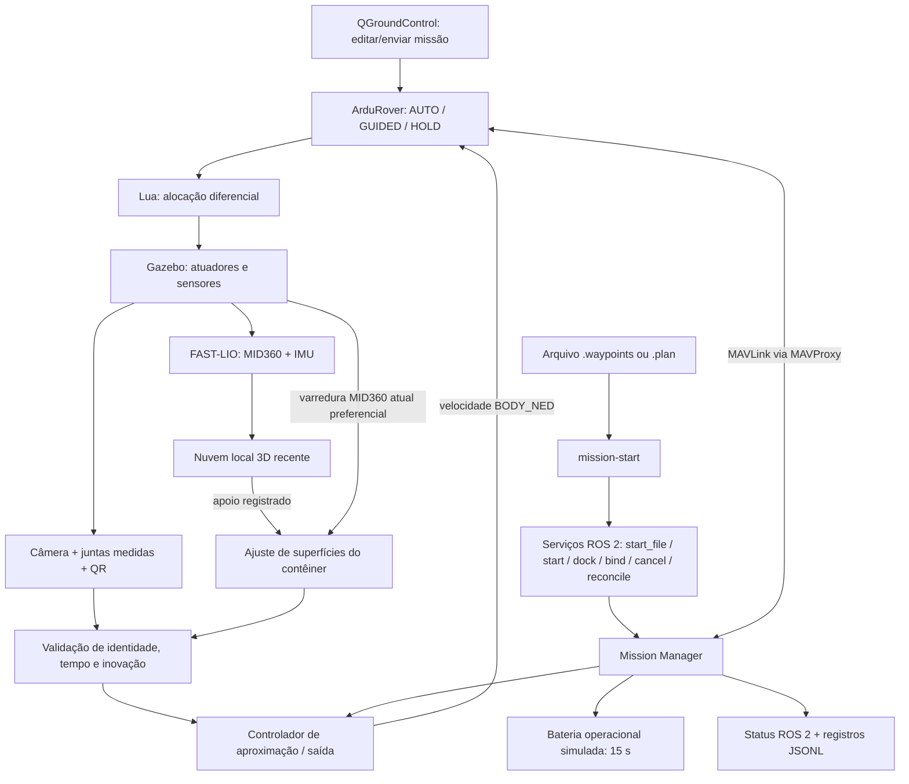
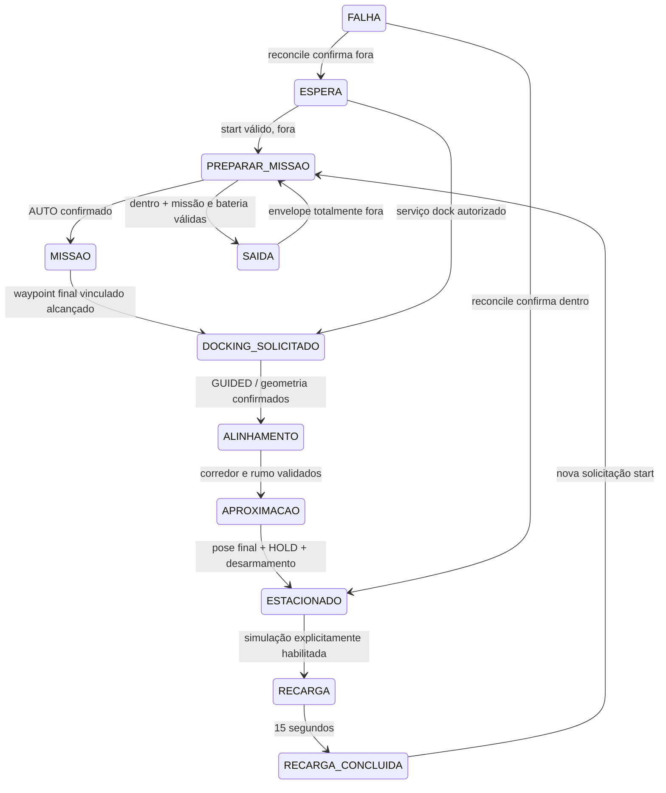

# Arquitetura do Mission Manager — ROS 2 / ArduRover

Revisão: 10/11/2026. O resultado dos ensaios desta revisão está em
[TESTES.md](TESTES.md); implementação e teste de unidade não equivalem à
validação de movimentos. O [tutorial](TUTORIAL.md) descreve a operação.

## Fluxo de responsabilidade

O arquivo pode ser enviado pelo cliente `mission-start`, sem upload prévio pelo
QGroundControl. O QGroundControl continua exibindo a telemetria original.
O Mission Manager tem uma única conexão de comando pelo `--out` UDP do
MAVProxy. Não abre serial ou TCP diretamente com o autopiloto. O FAST-LIO usa
outra saída do MAVProxy, já existente, para comunicar a pose ao Lua.

## Arquivos e interfaces

Caminhos relativos a `Rover/`:

| Arquivo | Responsabilidade |
| --- | --- |
| `python/mission_manager/clock_sync.py` | Sincronização de relógio ROS/boot via TIMESYNC; filtra RTT alto e respostas alheias e detecta saltos de relógio |
| `python/mission_manager/manager.py` | Supervisão, serviços ROS 2, transações MAVLink, missão pendente, vínculo da missão e reconciliação |
| `python/mission_manager/files.py` | Importação WPL/Plan, validação estrita e comparação de todos os parâmetros no readback |
| `python/mission_manager/start_mission.py` | Cliente ROS 2 que envia o caminho do arquivo; não abre conexão MAVLink |
| `ros2/src/rover_mission_interfaces/srv/StartMission.srv` | Contrato do serviço `start_file`: caminho absoluto, aceite e diagnóstico |
| `python/mission_manager/policy.py` | Máquina de estados, rampa de recarga e SOC operacional confirmado pelo ArduPilot |
| `python/mission_manager/charging.py` | Guardas de recarga SITL, comando nativo BATTERY_RESET e confirmação por BATTERY_STATUS/SYS_STATUS |
| `python/mission_manager/mission.py` | Validação dos itens, SHA-256 da missão e vínculo explícito do waypoint final a uma estação |
| `python/mission_manager/perception.py` | Trabalhadores de percepção: LiDAR e QR opcional, sem comandos de locomoção |
| `python/mission_manager/geometry.py` | Envelope físico, corredor, confirmação de saída e inovação visual limitada |
| `python/mission_manager/motion.py` | Operações reutilizáveis de entrada/saída; parada, confirmações, limites e restauração de parâmetros |
| `python/common/docking_stations.py` | Leitor do cadastro compartilhado `estacoes_recarga.txt` |
| `python/docking_lidar/sensores.py` | Entrega/tempo/frame da nuvem, associação GPS inicial e odometria local |
| `python/docking_lidar/geometria.py` | Ajuste robusto de superfícies finitas 3D; exige fundo e pelo menos uma lateral |
| `python/docking_lidar/referencia.py` | Referência GPS inicial e deslocamento de ré via FAST-LIO |
| `python/docking/visual_alignment.py` | Controlador existente reaproveitado: reposicionamento externo, parada/giro, alinhamento e avanço |
| `python/docking/relative_pose.py`, `qr_refinement.py` | Modelo calibrado de câmera/juntas, reconstrução do plano QR e refinamento |
| `python/docking/controle_saida.py` | Coordenadas do eixo; o giro legado desse módulo não é usado pelo Mission Manager |
| `python/missions/mavproxy_link.py` | ACK de comandos, confirmação por HEARTBEAT/PARAM_VALUE, protocolo de missão e telemetria |
| `python/slam/fast_lio/run_fast_lio.py` | LiDAR/IMU → FAST-LIO → ROS 2 / Lua |
| `python/slam/slam_mid360_3d.py` | Mapa para visualização e janela local recente para controle |
| `scripts/rover-controlallocation.lua`, `scripts/modules/functions.lua` | Alocação aos motores; permanece sob os controladores ArduRover |
| `scripts/lidar_odometry.lua` | Recepção de odometria; não é o Mission Manager |
| `Parameters.h`, `Parameters.cpp`, `mode_auto.cpp` | Intertravamento persistente `DOCK_LOCK` nesta compilação do firmware |
| `ros2/service.sh` | Ambiente Jazzy/Python, serviços e exclusão mútua entre controladores |
| `ros2/launch/simulation.launch.py` | Servidor sem GUI usa renderização normal; EGL é uma escolha explícita devido à perda de setores observada |
| `ros2/sitl.sh` | Inicialização do SITL/MAVProxy; fluxo de telemetria a 10 Hz |

Não há alteração de missão no controlador de movimento. O gerenciador lê a
missão existente, seleciona seu primeiro item para **novo início**, e não envia
outro `MISSION_START` após AUTO. Nesta versão de `mode_auto.cpp`, entrar em AUTO
já aciona `mission.start_or_resume()`; o início em seq 1 atende aos dois valores
normais de `MIS_RESTART` sem alterar esse parâmetro.

## Máquina de estados

Qualquer operação pode ir para `FALHA`. A recarga concluída não cria solicitação
de missão. GUIDED manual também não cria solicitação de saída. Pedidos repetidos
ou incompatíveis são recusados; `success=true` no serviço significa pedido
aceito, e o resultado posterior aparece no status/eventos.

## Solicitação de docking pela missão

Foi escolhida **sinalização na aplicação**, sem comando de paraquedas/relé:

1. `start_file` lê e valida o arquivo, salva a missão anterior, envia pelo
   MAVProxy e compara a leitura de volta antes de autorizar movimento.
2. Tanto `start_file` quanto `start` vinculam automaticamente o último waypoint
   à estação de destino e gravam o hash. `bind` permanece como opção explícita.
   HOME e campos de transporte ficam fora do hash. A estação de destino não
   substitui a estação física atual usada para autorizar a saída.
3. O gerenciador exige `MISSION_ITEM_REACHED` daquele waypoint, item ativo
   correspondente, AUTO e estação a menos de 8 m.
4. Antes de comandar a entrada, relê a missão e confirma que o hash não mudou.
5. Afirma `DOCK_LOCK`, confirma GUIDED e transfere o controle ao docking.

O vínculo é recriado automaticamente em cada início solicitado ao gerenciador.
Alterações externas na missão invalidam o hash. Vincula-se o **waypoint final**:
assim não existe um próximo trecho que possa começar enquanto o evento é
processado. O progresso suspenso fica no registro; uma nova solicitação `start`
sempre inicia em seq 1, sem retomar silenciosamente a missão anterior.

Alternativas examinadas no código local:

- `MAV_CMD_DO_SET_RELAY` chega a `AP_ServoRelayEvents::do_set_relay`: é uma
  atuação física, não uma mensagem inofensiva para o companion.
- `MAV_CMD_DO_AUX_FUNCTION` executa `rc().run_aux_function` com a função pedida.
- Paraquedas é uma função crítica e foi excluído.
- `NAV_SCRIPT_TIME` existe em `Rover/mode_auto.cpp`, mas depende do protocolo Lua
  de scripting e configuração de missão específica; não é necessário para o
  vínculo escolhido.

Fontes: código local em `libraries/AP_Mission/AP_Mission_Commands.cpp` e
`Rover/mode_auto.cpp`; definições oficiais de mensagens e comandos no
[MAVLink common](https://mavlink.io/en/messages/common.html).

## Intertravamento de AUTO

`DOCK_LOCK` é um parâmetro **novo deste fork**, não um parâmetro padrão disponível
em todo ArduPilot. É zero por padrão. Com valor diferente de zero:

- `ModeAuto::_enter()` rejeita AUTO antes da execução da missão;
- `ModeAuto::update()` também para uma missão AUTO já ativa;
- GUIDED/HOLD e as verificações normais de armamento continuam disponíveis.

O manager exige esse parâmetro. Não faz fallback para uma troca reativa de modo.
Mantém o bloqueio durante entrada, estacionamento, recarga e saída. Só limpa
após confirmação externa completa. Após falha/reinício, reconcilia posição,
estado do autopiloto e geometria; não retoma uma missão pendente automaticamente.

Isso não impede um operador de alterar manualmente o próprio `DOCK_LOCK` nem
protege um firmware sem esta alteração. Não use `DOCK_LOCK=0` como atalho dentro
da estação. Para hardware real, esse intertravamento precisa ser compilado,
revisado e validado no alvo; as rotinas desta entrega exigem SITL.

## Referenciais, qualidade e envelope

O mapa global acumulado serve para visualização. O ajuste prefere a varredura
atual `/rover_argo_N1/Instance1/livox/lidar` para reduzir a latência. Se ela não
contiver superfícies suficientes, tenta `/rover_slam_3d/local_cloud`, uma janela
recente compensada pela odometria local. Ambas passam pelos mesmos critérios
de geometria e idade máxima de 0,6 s. A faixa de movimento usa a varredura atual,
não um mapa antigo ou sujeito a saltos de fechamento de laços.

O LiDAR fornece XYZ no frame IMU/body; o adaptador existente aplica o
extrínseco para a base (`x=-0,003 m`, `z=0,434 m`). O QR usa a calibração da câmera
e posições das juntas medidas no tempo da imagem. Ambos chegam ao estimador
como centro da estação no referencial da base: frente/direita, com a mesma
convenção de erro de rumo. GPS associa a estação e inicializa o ajuste. Se a geometria não estiver visível,
é permitido somente um giro de aquisição na região frontal externa (ao menos
2 m do centro, com margem adicional pelo envelope). O giro usa rumo/GPS e
varredura LiDAR recente para vetar obstáculos. Não há avanço por GPS nessa
fase; depois do giro, as paredes precisam ser medidas e estáveis.

O ajuste limita a amostra a 1.200 pontos distribuídos após a seleção espacial,
preservando os testes de fundo/lateral, cobertura, RMS e timestamps. O OpenCV
usa uma thread nesse processo para não disputar todos os núcleos com os sensores.

O LiDAR é obrigatório. QR correto, reprojeção ≤ 1 px, diferença de tempo ≤ 0,12 s,
rover parado e concordância ≤ 15 cm / 8° permitem inovação limitada. O peso visual
é no máximo 15%, limitado a 1,5 cm / 0,5° por estimativa. Com divergência, QR errado,
movimento ou leitura ausente, mantém-se o LiDAR e registra-se a decisão.
Não há média direta entre frames ou poses de instantes incompatíveis.

O envelope padrão conservador é 0,60 × 0,54 × 0,65 m, margem de 0,06 m. O alvo
pode compensar o deslocamento entre base_link e centro físico via arquivo JSON
`--envelope`. A entrada exige que esse envelope caiba. A conclusão exige
posição ≤ 7 cm, rumo ≤ 5°, contenção física, observações distintas estáveis,
parada e desarmamento confirmados. Isso confirma **geometria**, não contato
elétrico: ainda não há sensor de encaixe/corrente do carregador.

Quando a pose inicial não está na região frontal, o reposicionamento calcula
trechos externos ao retângulo da estação inflado pelo raio de giro do rover.
Se não houver margem para manobrar, recusa; obstáculos medidos na faixa de
movimento vetam os trechos. Esse recurso não é um planejador global de mapa e
não deve ser confundido com uma validação de navegação em ambiente arbitrário.

A saída recua 3 m a partir da posição estacionada. A distância longitudinal
vem do ajuste geométrico das paredes, atualizado durante todo o recuo.
FAST-LIO fornece a correção de alinhamento e uma verificação independente de
movimento; sua translação acumulada é registrada, mas não determina a parada.
Na simulação foi observada divergência entre essa translação e a distância
real, mesmo com mensagens recentes. Não se corrige isso aumentando o recuo.

Há varredura de obstáculos atrás do rover, desaceleração perto do alvo e
confirmação de parada e de envelope completamente fora. A distância geométrica
final deve ficar a até 15 cm do alvo de 3 m; o desvio lateral continua limitado
a 12 cm e o de rumo a 12°, tanto no LiDAR quanto no FAST-LIO. Dados geométricos
ausentes param o movimento e têm um prazo limitado para recuperação; saltos
ou perda de alinhamento abortam a saída.
Só depois o gerenciador restaura parâmetros e libera a missão.

Não há etapa de giro de saída, nem o antigo teste de deslocamento de 40 cm
durante o giro. Os eventos `exit_reverse` registram o recuo e `exit_check`
registra ambas as medições finais, alinhamento e folga, com
`strategy=reverse_only`. As rotinas independentes de saída são separadas deste fluxo.

## Concorrência e falhas

O processo principal é o único leitor/comandante MAVLink. As transações usam
ACK e o estado reportado; operações mantêm o processamento da telemetria.
Dois trabalhadores independentes processam LiDAR e QR. O executor ROS 2 recebe
pedidos e publica status enquanto o movimento está em andamento. Os pedidos
entram em fila limitada, sem criar outro controlador concorrente.

O launcher compartilha `docking-controller.lock` com as entradas/saídas antigas.
O manager não deve coexistir com esses controladores. Parâmetros temporários de
obstáculos/giro são registrados antes de alterar e restaurados depois da parada;
o arquivo de recuperação sobrevive à interrupção do processo.

Watchdogs e tempos máximos cobrem dados, modo, fases e movimento. Perda apenas
do QR não para o rover. LiDAR perdido, salto de pose, obstáculo, falha de modo
ou saída inválida causam parada/HOLD e `FALHA`; uma saída falha não autoriza AUTO.
O timeout de comandos GUIDED e os failsafes nativos permanecem necessários
quando o computador ou a comunicação deixa de responder completamente.

## Bateria

O estado real vem de `BATTERY_STATUS` da bateria 0 e conserva validade temporal.
A recarga simulada é habilitada por padrão (`--simulate-charge`; desative com
`--no-simulate-charge`). `SITLCharger` verifica SIMSTATE recente, parâmetros
SIM_*, monitor analógico 4, capacidade configurada, geometria estacionada, HOLD,
parada e desarmamento. O SOC inicial vem da telemetria, não de um valor local.

Durante 15 segundos de relógio monotônico, solicita percentuais crescentes via
`MAV_CMD_BATTERY_RESET`, máscara 1 (bateria 0), a aproximadamente 1 Hz. O comando
nativo atualiza o consumo acumulado em mAh/Wh no AP_BattMonitor. O ArduPilot
publica as mensagens para o QGroundControl; o companion não forja telemetria.
Cada atualização exige ACK e confirmação por BATTERY_STATUS. A conclusão exige
também SYS_STATUS=100%. Se houver recusa ou timeout, o manager entra em falha.

Esse mecanismo redefine a estimativa de carga do SITL: não acrescenta um modelo
físico de carregador nem altera tensão, corrente ou capacidade nominal. A
configuração validada usa SIM_BATT_CAP_AH=0; modelos dinâmicos ou monitores de
baterias inteligentes são recusados por esta integração. Após sair da estação,
o consumo e o SOC operacional voltam a seguir exclusivamente o monitor do SITL.

A reconciliação também inicia recarga quando confirma o rover estacionado,
parado e desarmado. Um arquivo solicitado durante a recarga é validado,
enviado, conferido e fica pendente; a saída só começa após `RECARGA_CONCLUIDA`.
Erros de entrada anteriores ao upload são rejeitados sem interromper a recarga.
Falhas de protocolo ou movimento continuam levando a `FALHA`/HOLD.

O limiar inicial é configurável (`--minimum-soc`, padrão 30%). Sem modelo de
consumo calibrado, não se afirma que a energia garante qualquer missão. A
estrutura admite uma estimativa futura; hoje usa limiar e consumo informado
pelo ArduPilot. Sem simulação, bateria ausente/desatualizada
não autoriza início.

## Relógios e validação do início

`ATTITUDE.time_boot_ms` usa o relógio de inicialização do ArduPilot, enquanto
`/clock` vem do Gazebo. Esses horários não devem ser subtraídos diretamente.
`BootClock` envia TIMESYNC pelo mesmo MAVProxy, aceita apenas respostas com o
identificador do pedido e pelo menos três amostras de sincronização. Usa a
amostra com menor tempo de ida/volta entre amostras recentes, rejeitando RTT
maior que 0,3 s; depois renova a estimativa a cada 5 s.

A validade da atitude continua limitada a 0,5 s após converter o timestamp
para a base de tempo ROS, além dos limites de recebimento por relógio monotônico.
Sincronização com mais de 30 s, reinício do relógio ou salto de offset invalidam
a referência; não são tratados como movimento válido. Offset e diagnóstico
ficam publicados em `clock_sync` e registrados nos eventos.

Antes de alterar a missão, o pedido aguarda dados recentes de movimento por
um prazo limitado. Falta de dados nesse ponto gera `RequestRejected`, mantendo
estação/recarga. Durante uma parada em HOLD, atraso transitório mantém comandos
zerados e reinicia a confirmação de estabilidade; o timeout continua valendo.
