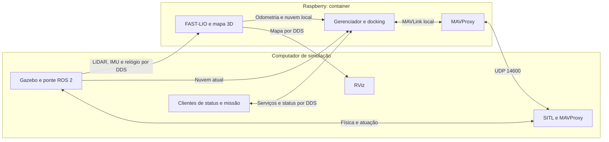

# Raspberry como computador de bordo — ROS 2 e Docker

**Raspberry atual: Pi 5, `rover@192.168.0.167`.** Instalação do zero e troca de perfil:
[SITL/Gazebo](INSTALACAO_PI5_SIMULACAO.md) e
[rover real / camada de abstração](INSTALACAO_PI5_ROVER_REAL.md).
O [relatório da Pi 4](VALIDACAO.md) é histórico; os ensaios da nova máquina
ficam no [relatório da Pi 5](VALIDACAO_PI5.md).

Na nova instalação, um ciclo de missão, entrada e recarga passou; a repetição
partindo de dentro falhou na saída por alinhamento/odometria. A sequência
automática completa com saída ainda não está validada nesta Pi/rede.

Guias rápidos com comandos por terminal:
[controle local](../simulacao/TUTORIAL_RAPIDO_LOCAL.md) e
[controle na Raspberry](TUTORIAL_RAPIDO_REMOTO.md).

## Distribuição dos serviços

| Computador de simulação | Raspberry `rover@192.168.0.167` |
| --- | --- |
| Gazebo e ponte Gazebo/ROS 2, sensores simulados e `/clock` | FAST-LIO, odometria, mapa 3D e nuvem local |
| ArduRover SITL, Lua e MAVProxy ligado ao SITL | MAVProxy de distribuição para os serviços de bordo |
| RViz e QGroundControl | Mission Manager: missão, docking, saída e recarga simulada |
| Clientes ROS de status, início, cancelamento e reconciliação | Desvio de obstáculos opcional; código das rotinas independentes incluído |



O container usa ROS 2 Jazzy/Python 3.12 ARM64 e rede do host. FAST-LIO é o
SLAM selecionado neste perfil. Não executa GLIM simultaneamente. Os sensores
vêm do computador pela rede; não é necessário colocar Gazebo na Raspberry.
A transferencia inicia uma nova sessao de SLAM; o mapa anterior pode ser
exportado ao encerrar o processo local, mas nao e importado automaticamente
para o estimador remoto.
A Raspberry precisa receber nuvens e IMU recentes: enxergar nomes de tópicos
não garante que os dados estão chegando.

O perfil inicial usa LiDAR para docking, com `no_qr: true`, e desvio desligado.
O voxel do mapa visual tem 6 cm e limite de 100 mil pontos. O FAST-LIO usa
voxels de 10 cm, amostragem de um a cada oito pontos simulados no adaptador
e filtragem adicional no estimador para reduzir CPU/memória. O ajuste das
paredes do docking continua usando a nuvem atual do MID360. Os limites de idade
dos sensores não foram aumentados para acomodar a rede.

## Endereços e comunicação

Não foi configurado IP fixo nem mDNS. O destino atual é `192.168.0.167`.
O nome `rover.local` pode ser uma alternativa futura quando mDNS estiver
configurado e a rede permitir multicast. Um IP estático não é universal entre
roteadores com sub-redes distintas.

ROS 2 usa `ROS_DOMAIN_ID=0` e Fast DDS via UDP entre computadores. Dentro do
container, os processos podem usar memória compartilhada. RViz e
clientes locais veem os tópicos e serviços publicados pela Raspberry. Mantenha
os computadores na mesma rede, sem isolamento de clientes.

`config/fastdds.xml` reserva segmentos SHM de 16 MiB por participante dentro
do container, cuja área `/dev/shm` tem 256 MiB. O padrão de 512 KiB é menor
que uma nuvem de 1,4 MiB e pode perder dados fragmentados, conforme a
[documentação do Fast DDS](https://fast-dds.docs.eprosima.com/en/2.x/fastdds/transport/shared_memory/shared_memory.html).

A ponte C++ `rover_companion_bridge/sensor_ingress` recebe a nuvem com QoS
RELIABLE e a distribui em `/rover_argo_N1/Instance1/livox/lidar_onboard`.
Os pontos, campos e timestamps são preservados. FAST-LIO e docking consomem
essa cópia local; somente um leitor da Raspberry recebe a nuvem pela rede.
O Gazebo publica relógio, IMU, nuvem e imagens por processos separados;
`/clock` usa timestamps exatos do simulador, limitados a 50 Hz de simulação.

Na Raspberry, `simulation_adapter` converte a nuvem para o formato Livox do
FAST-LIO em C++. Conserva a ordem, a amostragem e o instante de aquisição do
adaptador Python, evitando criar milhares de objetos Python por mensagem.
Esse adaptador é exclusivo do Gazebo; o perfil físico usa os tempos por ponto
publicados pelo driver Livox.

O gerenciador usa `--geometry-process`: o ajuste das paredes e a preparação
geométrica rodam em um processo de cálculo separado. Esse processo não abre
ROS ou MAVLink e não envia comandos; o gerenciador continua sendo o único
responsável por aceitar a pose e comandar o rover. Isso evita a disputa entre
o cálculo Python, a recepção ROS e a leitura de telemetria no mesmo processo.

O mapa acumulado usado pelo RViz é preservado quando uma nuvem chega atrasada.
A nuvem local usada na proteção é invalidada nesse caso e só volta com dados
recentes. Reinício do relógio ou descontinuidade da odometria continuam limpando
as referências incompatíveis. Reiniciar o processo de SLAM inicia outro mapa.

O MAVProxy do computador envia telemetria ao UDP **14600** da Raspberry. Dentro
do container, outro MAVProxy distribui o fluxo em loopback: **14551** para o
manager, **14556** para FAST-LIO/Lua e **14557** para o desvio. As respostas
retornam pelo mesmo caminho. QGroundControl permanece na saída local 14550.

## Instalação e atualização

Principais arquivos desta implantação:

| Arquivo | Função |
| --- | --- |
| `companion/Dockerfile` e `requirements.txt` | ROS Jazzy, bibliotecas Python, driver Livox e compilação ARM64 |
| `companion/compose.yaml` e `config/` | Recursos, rede DDS, volumes e perfis simulado/físico |
| `companion/stack.py` | Inicialização, espera pelos sensores e encerramento dos serviços |
| `ros2/src/rover_companion_bridge/` | Recepção nativa da nuvem e adaptação simulada para FAST-LIO |
| `python/mission_manager/geometry_worker.py` | Cálculo geométrico separado do controle e da telemetria |
| `companion/control.sh` e `mission_remote.py` | Comandos locais, cópia da missão e chamada do serviço remoto |
| `companion/configure_dds_buffers.sh` | Ajuste persistente dos buffers de rede, com cópia dos valores anteriores |

Os resultados medidos e os limites da validação estão no [relatório de testes](VALIDACAO.md).

Código da imagem: [`../../companion/Dockerfile`](../../companion/Dockerfile).
Instalação no destino: `~/rover_companion`. A imagem se chama
`rover-companion:jazzy`, e o container, `rover-companion`.

Para instalar o Docker em uma Raspberry Ubuntu 24.04 nova, copie e execute
`Rover/companion/install_docker.sh` com sudo. A autenticação fica no terminal;
nenhuma senha deve ir para a imagem, configuração ou repositório.

Prepare buffers UDP para as mensagens grandes, **nos dois computadores**:

```bash
# Neste computador:
sudo bash ~/ardupilot/Rover/companion/configure_dds_buffers.sh
# Na Raspberry, após enviar os fontes:
ssh -t rover@192.168.0.167 \
  'sudo bash ~/rover_companion/source/companion/configure_dds_buffers.sh'
```

O script estabelece mínimos de 8 MiB para os buffers de envio/recepção e,
na revisão da Pi 5, mínimo de 64 MiB para remontagem IP com retenção de
fragmentos incompletos de no máximo 3 s;
guarda os valores anteriores em `/var/lib/rover-companion/dds-buffers-before.txt`
e não altera IPs ou rotas. Reinicie as pontes ROS e o container para recriar
os sockets. Na instalação de 11/11/2026, o ajuste foi aplicado na Raspberry
e também neste computador, com autenticação local do operador. O complemento
de remontagem IP da revisão de 12/11 exige executar novamente o script;
o backup adicional fica em `dds-fragments-before.txt`.

Para enviar o código e compilar a imagem:

```bash
cd ~/ardupilot/Rover
./companion/deploy.sh
```

Isso não inicia o controle. A compilação ocorre nativamente em ARM64, com um
processo de compilação por vez. Arquivos anteriores de configuração são
preservados. Depois de uma atualização, pare e recrie o container com o rover
parado; processos Python já iniciados não recarregam o código.

Na construção anterior na Raspberry Pi 4 de 4 GB, a compilação C++ do FAST-LIO
exigiu swap temporário adicional. A Pi 5 atual tem 16 GB de RAM.
Se for reconstruir as dependências do zero em outra máquina de 4 GB, prepare
2 GB temporários na Raspberry:

```bash
cd ~/rover_companion
# Execute somente se build.swap ainda não existir.
sudo fallocate -l 2G build.swap
sudo chmod 600 build.swap
sudo mkswap build.swap
sudo swapon build.swap
```

Após a compilação, com os serviços ainda parados, remova-o:

```bash
sudo swapoff ~/rover_companion/build.swap
sudo rm ~/rover_companion/build.swap
```

Esses comandos não alteram `/etc/fstab`. O swap não substitui a verificação
de memória e desempenho dos serviços em operação.

## Inicialização do zero, usando a simulação neste computador

### Terminal 1: Gazebo local

```bash
cd ~/ardupilot/Rover
source companion/pc_env.bash
./ros2/service.sh gazebo \
  world:=gravel_plane N:=1 start_x:=2.5 start_y:=-2 \
  real_time_factor:=0.5 \
  mid360_enabled:=true samsung_s23_ultra_cam_enabled:=true \
  insta360_enabled:=false hokuyo_enabled:=false
```

`real_time_factor:=0.5` faz um segundo simulado durar aproximadamente dois
segundos reais, reduzindo a carga na Raspberry Pi 4. A opção normal do lançador
continua sendo `1.0`. Esse ajuste não reduz velocidades em m/s, dimensões ou
resolução dos sensores; altera a velocidade de execução da simulação.

### Terminal 2: SITL local, encaminhando MAVLink para a Raspberry

```bash
cd ~/ardupilot/Rover
source companion/pc_env.bash
ROVER_COMPANION_HOST=192.168.0.167 \
  ./sim_1_gzrover.sh --foreground --add-param-file nrover_sem_desvio.param --no-rebuild
```

`ROVER_COMPANION_HOST` também aceita um nome resolvível. O ArduRover precisa
ser a versão deste projeto, com `DOCK_LOCK`. Lua e parâmetros continuam no SITL.
Com `ROVER_COMPANION_HOST`, o fluxo geral do MAVProxy inicia em 4 Hz; o
gerenciador solicita separadamente 10 Hz para as mensagens de supervisão.
`--streamrate HZ` permite escolher o fluxo geral. `--non-interactive` permite
executar o lançador sem console MAVProxy; em terminais normais, pode omiti-lo.

Se o SITL já estava aberto sem esse encaminhamento, pode reutilizar sua saída
local 14557 com a ponte abaixo, mantendo-a em outro terminal:

```bash
cd ~/ardupilot/Rover
python3 companion/mavlink_relay.py --remote 192.168.0.167
```

Use **um** caminho: encaminhamento direto no início do SITL **ou** essa ponte.
Não execute os dois ao mesmo tempo. A porta 14557 local precisa estar livre.

### Terminal 3: serviços de bordo na Raspberry

Encerre os processos locais de FAST-LIO, mapa, Mission Manager e rotinas de
docking antes de iniciar suas cópias remotas. Não deixe dois controladores ou
dois publicadores de odometria ativos. Não inicie `iniciar_simulacao_completa.sh`
junto deste fluxo, pois ele abre serviços locais.

```bash
cd ~/ardupilot/Rover
./companion/control.sh up
./companion/control.sh logs
```

O supervisor abre MAVProxy, ponte de nuvem, FAST-LIO e mapa; espera odometria e nuvem local
recentes; só então abre o gerenciador. Abrir o container não inicia uma missão.
O gerenciador reconcilia a posição e confirma HOLD. O reinício automático do
container está desativado: uma falha fica visível nos logs para diagnóstico.
Ao iniciar uma missão, `PREPARAR_MISSAO` também aguarda o EKF confirmar posição
absoluta, atitude e velocidade. Uma fixação GPS ainda sem solução de navegação
não autoriza armamento/saída; a espera tem limite de 90 segundos reais.

### Terminal 4: RViz local

```bash
cd ~/ardupilot/Rover
source companion/pc_env.bash
./ros2/service.sh rviz
```

Use `camera_init` como Fixed Frame. O mapa está em `/rover_slam_3d/map`, a nuvem
local em `/rover_slam_3d/local_cloud`, e a odometria em `/fast_lio/odometry`.
Não é necessário abrir RViz na Raspberry.

### Terminal 5: status e missão, chamados neste computador

```bash
cd ~/ardupilot/Rover
source companion/pc_env.bash
./companion/control.sh status
./companion/control.sh mission Missions/new_argo.plan
```

O segundo comando copia o arquivo para `~/rover_companion/missions` na
Raspberry e chama o serviço ROS a partir deste computador. O nome remoto é
baseado no conteúdo e é mostrado na tela. A mensagem de aceitação não significa
que a missão terminou; acompanhe:

```bash
./companion/control.sh watch
```

Os comandos ROS diretos continuam disponíveis:

```bash
ros2 topic echo /mission_manager/status --once --full-length
ros2 service call /mission_manager/reconcile std_srvs/srv/Trigger '{}'
ros2 service call /mission_manager/cancel std_srvs/srv/Trigger '{}'
```

Para chamar `start_file` diretamente, o arquivo precisa existir **no container**.
Por exemplo, copie primeiro:

```bash
scp Missions/new_argo.plan rover@192.168.0.167:rover_companion/missions/new_argo.plan
ros2 service call /mission_manager/start_file rover_mission_interfaces/srv/StartMission \
  "{mission_file: '/missions/new_argo.plan'}"
```

O caminho `/home/grin/ardupilot/...` é deste computador e não existe dentro do
container. `companion/control.sh mission` resolve essa diferença automaticamente.

## Encerramento e logs

O [guia rápido remoto](TUTORIAL_RAPIDO_REMOTO.md#parar-a-missão-e-encerrar-tudo)
detalha a ordem de fechamento de todos os terminais e a verificação dos processos.
Para controle local, use o
[encerramento local](../simulacao/TUTORIAL_RAPIDO_LOCAL.md#parar-a-missão-e-encerrar-tudo).

Para interromper o movimento, solicite cancelamento e confira HOLD/parada:

```bash
cd ~/ardupilot/Rover
./companion/control.sh cancel
./companion/control.sh status
```

Confirme `mode=4`, telemetria recente e parada; desarme antes de encerrar.
Depois, com Gazebo e SITL ainda abertos:

```bash
./companion/control.sh down
```

O supervisor encerra primeiro o gerenciador, mantendo a comunicação para a
parada; depois fecha mapa, FAST-LIO e MAVProxy. Gazebo e SITL locais continuam
abertos até serem encerrados em seus terminais. Após `down`, feche câmera e
RViz, depois SITL/MAVProxy e por último Gazebo, usando Ctrl+C e aguardando
cada processo terminar. Feche também o QGroundControl. Ctrl+C no acompanhamento
de logs/status não encerra os serviços; Ctrl+Z apenas suspende processos.

Verifique o encerramento remoto:

```bash
ssh rover@192.168.0.167 'cd ~/rover_companion && docker compose ps --all'
```

O comando `down` preserva a imagem e os dados persistentes; não desliga a Raspberry.

Os dados persistentes ficam na Raspberry:

```text
~/rover_companion/
  compose.yaml
  config/           perfis, cadastro e calibrações
  missions/         arquivos enviados deste computador
  data/simulation/  recuperação de parâmetros do SITL
  data/real/        recuperação separada para hardware físico
  data/latest.txt   diretório do último funcionamento
  data/runs/.../    logs, eventos, parâmetros e mapa exportado
  source/           código usado para construir a imagem
  build.log         log da compilação inicial
```

Para ver o log do manager:

```bash
ssh rover@192.168.0.167 'r=$(cat ~/rover_companion/data/latest.txt); tail -60 "$HOME/rover_companion/data/${r#/data/}/manager.log"'
```

Se o gerenciador estiver em FALHA, leia `last_error` no status completo. Corrija
a causa antes de reconciliar. HOLD é um modo do ArduPilot; não apaga sozinho o
estado de falha do aplicativo.

## Depois: usar a mesma imagem no rover físico

O perfil `config/real.yaml` usa o mesmo executável do gerenciador e a mesma
imagem. O driver oficial Livox e o SDK2 estão incluídos. A troca não consiste
apenas em mudar um IP:

| Item | Simulação atual | Preparação para veículo físico |
| --- | --- | --- |
| ArduPilot | SITL no computador | Dispositivo serial/USB e firmware com `DOCK_LOCK` e Lua compatível |
| MAVProxy | Entrada UDP 14600 | Porta e baudrate do autopiloto na Raspberry |
| Relógio ROS | `/clock` do Gazebo | Relógio real e sincronização dos sensores |
| MID360 | Nuvem simulada adaptada ao FAST-LIO | Driver Livox com timestamps por ponto preservados |
| Calibração | Transformações conhecidas do modelo | Posição IMU/base e extrínsecos LiDAR/IMU medidos |
| Estações | Coordenadas de `container_gravel_plane` | Cadastro GPS e dimensões das estações reais |
| Envelope | Dimensões do modelo | Dimensões físicas medidas e margens |
| Carga | Reset de SOC exclusivo do SITL | Telemetria real; requer integração com carregador para confirmar recarga |
| Câmera/QR | Câmera do Gazebo | Driver, intrínsecos, extrínsecos e tópicos reais antes de habilitar QR |

O perfil real está com `hardware_configured: false`; ele recusa iniciar nessa
condição. Preencha `hardware.yaml`, `envelope.json`, `livox.yaml` e o JSON do
MID360. Os modelos `.example.yaml` têm valores ilustrativos e são recusados
como calibração. O perfil atual exige eixos da IMU alinhados aos da base;
montagem diferente exige adaptar e validar as transformações antes do uso.

O driver real publica `CustomMsg` em `/livox/lidar` e IMU em `/livox/imu`.
O adaptador preserva os tempos reais, disponibiliza a nuvem normalizada ao
docking e configura os extrínsecos do FAST-LIO. A câmera real não é ativada
por este perfil inicial. Mantenha o desvio desligado até ajustar sua
configuração geométrica para o hardware.

Depois de configurar e validar hardware, pode-se acrescentar o acesso ao USB:

```bash
# Na Raspberry; etapa futura de comissionamento do hardware.
cd ~/rover_companion
ARDUPILOT_DEVICE=/dev/serial/by-id/SEU_AUTOPILOTO \
  docker compose -f compose.yaml -f compose.real.yaml up -d
```

A imagem não é executada em modo privilegiado. Só o dispositivo selecionado
é exposto nesse perfil. Os IPs e a ligação Ethernet do MID360 precisam ser
configurados conforme o sensor; isso não foi feito nesta instalação.
A operação com hardware físico ainda precisa de testes próprios. O Docker
não calibra sensores nem transforma a recarga simulada em uma carga elétrica.

## Diagnóstico de rede e processamento

A partir deste computador:

```bash
cd ~/ardupilot/Rover
source companion/pc_env.bash
python companion/network_probe.py --duration 15
ssh rover@192.168.0.167 'docker stats --no-stream rover-companion'
```

O diagnóstico é somente leitura: conta mensagens, mede idade pelo relógio ROS
e informa pontos por nuvem. Nuvens vazias de reset são contadas separadamente
e não entram na estatística de idade. `/clock` e sensores precisam continuar chegando
quando o rover está parado. Se odometria ou nuvem local pararem, o gerenciador
não deve continuar usando a última pose indefinidamente.

O perfil físico usa `ROS_DOMAIN_ID=20`, separado da simulação (domínio 0).
No computador de operação, execute `export ROS_DOMAIN_ID=20` antes de carregar
`companion/pc_env.bash` e de abrir os clientes ROS. Não misture os tópicos
do Gazebo com os sensores físicos.

O perfil físico não usa `/clock`: ao visualizar o veículo real, abra RViz com
`use_sim_time=false` e valide sincronização de horário entre os equipamentos.


Referências de instalação: [Docker Engine no Ubuntu](https://docs.docker.com/engine/install/ubuntu/)
e [driver oficial Livox para ROS 2 Jazzy](https://github.com/Livox-SDK/livox_ros_driver2).
